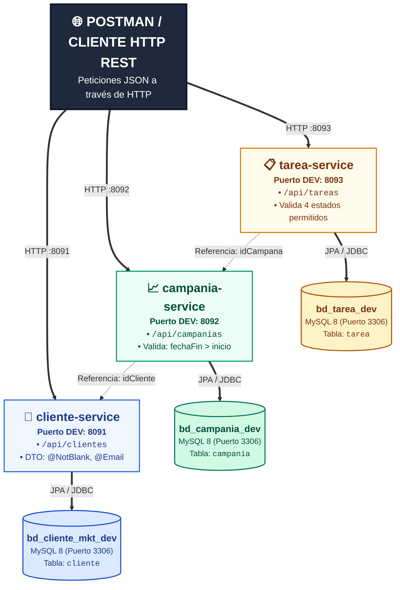

# EVALUACIÓN CONTINUA 03 (EVA 03)
## DESARROLLO DE APLICACIONES WEB AVANZADO: MICROSERVICIOS

* **Institución:** Tecsup
* **Curso:** Desarrollo de Aplicaciones Web
* **Docente:** Prof. Ricardo Coello Palomino
* **Estudiante:** ROCHA BOBADILLA, JESUS ENRIQUE
* **Tema Asignado:** LABORATORIO 19 — Gestión de Campañas de Marketing
* **Patrón de Arquitectura:** Database-per-Service (Microservicios con Spring Boot y MySQL 8)

---

## 1. DESCRIPCIÓN GENERAL DEL SISTEMA Y ARQUITECTURA

El presente proyecto da solución a la problemática de gestión comercial y operativa de una agencia de marketing digital. Para garantizar escalabilidad, aislamiento de fallas y despliegues independientes, la solución se diseñó bajo una arquitectura distribuida de microservicios siguiendo estrictamente el patrón **Database-per-Service**.

El sistema se compone de tres microservicios autónomos: **`cliente-service`**, responsable del registro y mantenimiento de anunciantes; **`campania-service`**, encargado de la planificación temporal y financiera de las campañas; y **`tarea-service`**, orientado al seguimiento de actividades operativas y control de sus estados. 

Para preservar la independencia de cada servicio, no existen restricciones de integridad referencial física (`FOREIGN KEY`) entre los esquemas de base de datos. La relación entre dominios se implementa a nivel lógico mediante identificadores foráneos (`idCliente` en las campañas e `idCampana` en las tareas), permitiendo que cada microservicio pueda modificarse, migrarse o escalarse sin comprometer a los demás.

### 1.1 Diagrama de la Arquitectura Distribuida

El sistema implementa una arquitectura desacoplada organizada en tres niveles jerárquicos: **Consumo (Postman)**, **Microservicios Autónomos (Spring Boot 3)** y **Persistencia Independiente (Database-per-Service en MySQL 8)**. La comunicación entre servicios se mantiene exclusivamente mediante identificadores numéricos lógicos (`idCliente` e `idCampana`), sin llaves foráneas entre esquemas de base de datos.

---

#### Mapa Estructural y Desacoplamiento de Datos (Database-per-Service)

Para una lectura directa y sin dependencia de renderizadores gráficos, la siguiente tabla detalla la distribución de responsabilidades, componentes y aislamiento de persistencia:

| Componente | Capa de Exposición | Capa de Negocio y Validación | Esquema MySQL 8 (Aislado) | Relación Inter-Servicio |
| :--- | :--- | :--- | :--- | :--- |
| **`cliente-service`** *(Puerto 8091)* | `ClienteController` `/api/clientes` | `ClienteDTO` (`@NotBlank`, `@Email`) `ClienteService` (CRUD) | **`bd_cliente_mkt_dev`** Tabla: `cliente` | Entidad raíz independiente. No depende de ningún otro servicio. |
| **`campania-service`** *(Puerto 8092)* | `CampaniaController` `/api/campanias` | `CampaniaDTO` (`@PositiveOrZero`) Valida: `fechaFin > fechaInicio` | **`bd_campania_dev`** Tabla: `campania` | Almacena `idCliente` como número (`Long`). **Sin Foreign Key física en BD**. |
| **`tarea-service`** *(Puerto 8093)* | `TareaController` `/api/tareas` | `TareaDTO` (`@NotBlank`) Valida: `[PENDIENTE, EN_PROCESO, COMPLETADA, CANCELADA]` | **`bd_tarea_dev`** Tabla: `tarea` | Almacena `idCampana` como número (`Long`). **Sin Foreign Key física en BD**. |

### 1.2 Matriz de Servicios, Puertos y Esquemas de Base de Datos

| Microservicio | Responsabilidad del Dominio | Puerto DEV | Puerto PROD | Esquema BD DEV | Esquema BD PROD |
| :--- | :--- | :---: | :---: | :--- | :--- |
| **`cliente-service`** | Mantenimiento de clientes corporativos y datos de contacto | **8091** | 9091 | `bd_cliente_mkt_dev` | `bd_cliente_mkt` |
| **`campania-service`** | Gestión de presupuestos, cronogramas y vinculación de cliente | **8092** | 9092 | `bd_campania_dev` | `bd_campania` |
| **`tarea-service`** | Asignación de responsables y ciclo de vida de tareas | **8093** | 9093 | `bd_tarea_dev` | `bd_tarea` |

---

## 2. CONFIGURACIÓN DE PERFILES Y AMBIENTES (application.yml)

La configuración de cada microservicio se administra mediante archivos YAML desacoplados de la lógica Java, implementando una separación limpia entre los entornos de desarrollo (`dev`) y producción (`prod`).

El archivo principal `application.yml` establece el perfil activo (`spring.profiles.active: dev`). En desarrollo, el archivo `application-dev.yml` habilita `ddl-auto: update` y `show-sql: true` para facilitar la inspección de sentencias SQL y la creación automática de tablas en esquemas con sufijo `_dev`. Por su parte, el archivo `application-prod.yml` asigna puertos productivos diferenciados (`9091`, `9092`, `9093`) y configura `ddl-auto: validate` para proteger la estructura de datos contra alteraciones accidentales en producción.

---

## 3. DISEÑO DE LA CAPA REST, VALIDACIONES Y MANEJO DE ERRORES

### 3.1 Uso de DTOs y Validación de Entrada
Para evitar la sobreexposición del modelo interno de persistencia y prevenir vulnerabilidades de asignación masiva de datos (*Mass Assignment*), todas las operaciones de entrada (`POST` y `PUT`) se procesan a través de objetos de transferencia de datos (**DTO**).

Se implementaron anotaciones de **Jakarta Bean Validation** como `@NotBlank`, `@Email`, `@PositiveOrZero` y `@NotNull`. De esta manera, solicitudes con campos vacíos, correos malformados o presupuestos monetarios negativos son filtradas y rechazadas de forma inmediata antes de ser transferidas a la capa de persistencia.

### 3.2 Reglas de Negocio en Capa de Servicio
En **`campania-service`**, se diseñó una regla de negocio temporal que verifica que la fecha de culminación (`fechaFin`) sea estrictamente posterior a la fecha de inicio (`fechaInicio`). En caso de inconsistencia cronológica, el servicio genera una excepción que interrumpe la transacción.

En **`tarea-service`**, se estableció un control estricto sobre el ciclo de vida de las actividades. Únicamente se admiten los estados: `PENDIENTE`, `EN_PROCESO`, `COMPLETADA` y `CANCELADA`. Cualquier intento de asignar un estado no tipado es rechazado automáticamente.

### 3.3 Manejo Centralizado de Excepciones (@RestControllerAdvice)
Cada microservicio incorpora la clase `GlobalExceptionHandler` anotada con `@RestControllerAdvice`. Este componente intercepta de manera uniforme:

* **`MethodArgumentNotValidException`:** Traduce errores de Bean Validation a un código **HTTP 400 Bad Request**, detallando el mapa de campos observados y sus respectivos mensajes explicativos.
* **`IllegalArgumentException`:** Convierte inconsistencias de reglas de negocio (fechas incoherentes, estados no autorizados) en respuestas **HTTP 400 Bad Request**.
* **`ResourceNotFoundException`:** Intercepta consultas a identificadores inexistentes retornando un código **HTTP 404 Not Found** en formato JSON.

Este mecanismo asegura que el cliente REST reciba respuestas estructuradas y limpias, eliminando la exposición de trazas internas del servidor (*stack traces*).

---

## 4. CATÁLOGO COMPLETO DE ENDPOINTS REST

### 4.1 Servicio de Clientes (`cliente-service` — Puerto 8091)
* **`GET /api/clientes`:** Retorna el listado completo de clientes registrados.
* **`GET /api/clientes/{id}`:** Retorna el detalle de un cliente específico por su ID.
* **`POST /api/clientes`:** Registra un nuevo cliente (valida nombre obligatorio y correo electrónico válido).
* **`PUT /api/clientes/{id}`:** Actualiza la información de un cliente existente.
* **`DELETE /api/clientes/{id}`:** Elimina el registro del cliente por ID.

### 4.2 Servicio de Campañas (`campania-service` — Puerto 8092)
* **`GET /api/campanias`:** Consulta el catálogo de campañas de marketing.
* **`GET /api/campanias/{id}`:** Retorna la información de una campaña por ID.
* **`GET /api/campanias/cliente/{idCliente}`:** Filtra las campañas que pertenecen a un cliente determinado.
* **`POST /api/campanias`:** Registra una campaña (valida presupuesto no negativo, idCliente existente y coherencia de fechas).
* **`PUT /api/campanias/{id}`:** Actualiza presupuesto, fechas y estado de la campaña.
* **`DELETE /api/campanias/{id}`:** Elimina la campaña indicada.

### 4.3 Servicio de Tareas (`tarea-service` — Puerto 8093)
* **`GET /api/tareas`:** Lista todas las tareas operativas del sistema.
* **`GET /api/tareas/{id}`:** Obtiene el detalle de una tarea por ID.
* **`GET /api/tareas/campana/{idCampana}`:** Lista las tareas asociadas a una campaña específica.
* **`GET /api/tareas/estado/{estado}`:** Filtra tareas por su estado actual (`PENDIENTE`, `EN_PROCESO`, `COMPLETADA`, `CANCELADA`).
* **`POST /api/tareas`:** Crea una nueva tarea asignada a una campaña con estado por defecto `PENDIENTE`.
* **`PUT /api/tareas/{id}`:** Modifica la descripción y responsable de la tarea.
* **`PUT /api/tareas/{id}/estado`:** Actualiza controladamente el estado de la tarea (valida estados permitidos).
* **`DELETE /api/tareas/{id}`:** Elimina el registro de la tarea.

---

## 5. PRUEBAS DE ACEPTACIÓN CON POSTMAN

Para la verificación integral del sistema, se suministra el archivo **`Eva03_Marketing_Postman_Collection.json`**, el cual contiene 22 peticiones organizadas por servicio con aserciones de prueba automáticas (`pm.test`).

### 5.1 Flujo de Aceptación Exitoso
1. **Creación de Cliente:** Se envía una petición `POST` al puerto 8091 con los datos de *TechCorp Solutions SAC*. El servicio responde con código **`201 Created`** y genera el `id: 1`.
2. **Creación de Campaña:** Se envía una petición `POST` al puerto 8092 vinculada al `idCliente: 1`, con fecha de inicio `2026-11-15` y fin `2026-11-30`, presupuesto de `18500.0`. Responde con código **`201 Created`** y genera el `id: 1`.
3. **Creación de Tareas:** Se envían solicitudes `POST` al puerto 8093 con `idCampana: 1`. Las tareas quedan registradas con estado inicial **`PENDIENTE`** y código **`201 Created`**.
4. **Transición de Estados:** Se actualiza el estado de la tarea 1 mediante una petición `PUT /api/tareas/1/estado` cambiando primero a **`EN_PROCESO`** y luego a **`COMPLETADA`**, recibiendo respuestas **`200 OK`**.

### 5.2 Pruebas de Error Controladas (Requisitos de Rúbrica)
1. **Presupuesto Negativo:** Al enviar `presupuesto: -5000.0` en la creación de campaña, el servicio responde con **`HTTP 400 Bad Request`** y el mensaje de error *"El presupuesto no puede ser negativo"*.
2. **Inconsistencia de Fechas:** Al registrar una campaña con `fechaInicio: 2026-12-25` y `fechaFin: 2026-12-10`, el sistema rechaza la solicitud con **`HTTP 400 Bad Request`** informando que la fecha de finalización no puede ser anterior al inicio.
3. **Estado no Permitido:** Al intentar actualizar una tarea con un estado no contemplado (por ejemplo `"FINALIZADA"`), el servicio retorna **`HTTP 400 Bad Request`** e indica la lista cerrada de estados permitidos.
4. **Recurso Inexistente:** Al consultar un ID no registrado en cualquier servicio (ejemplo `/api/clientes/999`), el sistema retorna de manera limpia **`HTTP 404 Not Found`**.
